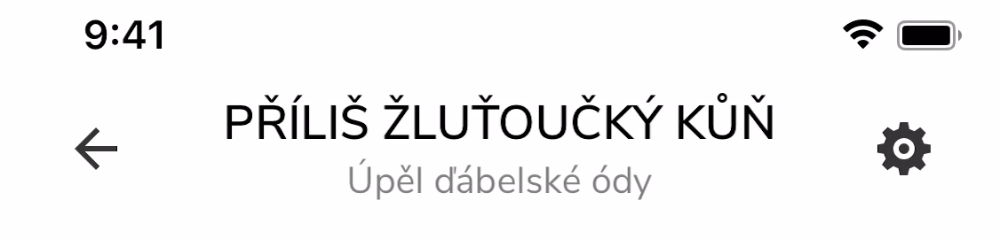

# [iOS 26+/27] NavigationPage.TitleView container is sized to the navigation bar frame height, shifted up by 5 pt and clipped (regression vs .NET 9)

### Description

On iOS 26.5 and iOS 27 a custom `NavigationPage.TitleView` is positioned 5 pt too high in the navigation bar. If the native
`UINavigationBar` has `clipsToBounds = true`, the top of the title view is cut off. Diacritics above capital letters
disappear (`PŘÍLIŠ ŽLUŤOUČKÝ KŮŇ` renders as `PRILIS ZLUTOUCKY KUN`).

The same code and the same `NavigationPage` setup on .NET 9 / MAUI 9.0.x renders correctly on the same iOS version.

Crop of the status bar and navigation bar, the same app and the same code for both target frameworks (debug builds from the attached project):

| Device, OS | net9.0-ios (MAUI 9.0.120) | net10.0-ios (MAUI 10.0.120) |
|---|---|---|
| iPhone 14 simulator, iOS 26.5<br>**affected** |  |  |
| iPhone 14 simulator, iOS 27.0<br>**affected** |  |  |
| iPhone 16e (device), iOS 27.2<br>**affected** |  |  |
| iPhone 14 simulator, iOS 18.6<br>works (not affected) |  |  |
| iPhone XS (device), iOS 18.7.10<br>works (not affected) |  |  |

On iOS 18 (navigation bar 44 pt) both target frameworks render the same, the title is complete. On iOS 26.5 and 27 (navigation bar 54 pt) only .NET 10 loses the top of the title.

### Steps to Reproduce

1. Open the attached project (`example/TitleViewRepro.csproj`, targets `net9.0-ios` and `net10.0-ios`, same code for both).
2. Run it on an iOS 26.5 or iOS 27 simulator with `net9.0-ios`, then with `net10.0-ios` (`cd example; ./run.sh net9`, `./run.sh net10`, or from the IDE;
   `SIM_RUNTIME=iOS-26-5 ./run.sh net10` selects the iOS 26.5 simulator).
   Each target framework needs the matching Xcode (26.5 for net9, 27.1 for net10), `run.sh` selects it through `DEVELOPER_DIR`.
3. Look at the title in the navigation bar.

**Expected:** the title is rendered the same way as on .NET 9, including the diacritics.
**Actual:** on .NET 10 the title is 5 pt higher and its top is clipped.

The `NavigationPage` is configured like this (the relevant part is `ClipsToBounds`, commonly used to hide the hairline under the bar):

```csharp
navBar.SetBackgroundImage(new UIImage(), UIBarMetrics.Default);
navBar.ShadowImage = new UIImage();
navBar.ClipsToBounds = true;
```

Without `ClipsToBounds = true` the title is only shifted up and nothing is cut off, so the layout is wrong in both cases.

### Native layout (dump from the attached project, iPhone 14 simulator with iOS 26.5 and 27.0, iPhone 16e with iOS 27.2)

The navigation bar is 54 pt high in all these runs (`UINavigationBar.sizeThatFits` returns 54). The frames below are identical
on the iOS 26.5 simulator (`results/simulator-iPhone14-iOS26.5/`), on the iOS 27.0 simulator (`results/simulator-iPhone14-iOS27.0/`)
and on the physical iPhone 16e with iOS 27.2 (`results/iPhone16e/`); each folder has `net9-dump.txt` and `net10-dump.txt`.
On the iPhone XS with iOS 18.7.10 (`results/iPhoneXS/`) and on the iOS 18.6 simulator (`results/simulator-iPhone14-iOS18.6/`) the bar is 44 pt and the container is as high as the bar on both target frameworks.

| | .NET 9 (MAUI 9.0.120) | .NET 10 (MAUI 10.0.120) |
|---|---|---|
| `NavigationRenderer.Container` frame | `(0,0 358×44)` | `(0,0 358×54)` |
| system title wrapper `UIView` frame | `(16,0 358×44)` | `(16,-5 358×54)` |
| `MauiControlsNavigationBar` | `(0,47 390×54)`, clips True | `(0,47 390×54)`, clips True |

Ancestors of the title label on .NET 10 (from `results/simulator-iPhone14-iOS27.0/net10-dump.txt`, the same on iOS 26.5):

```
Container                  (0,0   358×54)  clips True   autoresizing FlexibleDimensions
UIView                     (0,0   358×54)
UIControl                  (0,0   358×54)
UIView                     (16,-5 358×54)               <- 5 pt above the bar's content
UIView ×3                  (0,0   390×54)
MauiControlsNavigationBar  (0,47  390×54)  clips True
```

The wrapper's centre is at y = 22, i.e. it is centred in a 44 pt area, while the container asks for 54 pt. (The 44 pt area itself is not
visible in the view hierarchy, this is inferred from the numbers.)

### Suspected cause

In `NavigationRenderer.cs`, class `Container`:

* **MAUI 9.0.90 and 9.0.120:** `ToolbarHeight` returns `Superview.Bounds.Height` (fallback 44 / 32). The container always has the height
  UIKit gives to the title wrapper.
* **MAUI 10.0.110 and 10.0.120:** on iOS 26+ `CreateTitleViewContainer` creates the container with `navigationBar.Frame`
  (`new Container(titleView, navigationBar, navigationBarFrame)`), the height is cached in `_navigationBarHeight`, and `ToolbarHeight`
  returns it before `Superview.Bounds.Height`. The `Frame` setter and `SizeThatFits` then force this height. On iOS 26.5 and 27 the navigation bar
  (54 pt) is taller than the area UIKit reserves for the title, so the wrapper overflows by 5 pt on both sides. On iOS 18 (iPhone XS, iOS 18.6 simulator) the bar
  is 44 pt, the heights agree and nothing is shifted.

According to the description of #39285 the explicit-frame sizing was introduced in #32798.

This is related to #39155 (zero-height container when the bar has not been laid out yet), but the fix for it (#39285, in 10.0.120)
does not change this behaviour: the dump above is from 10.0.120.

It is not specific to the simulator: the attached project gives the same container size and `-5` offset on a physical iPhone 16e with iOS 27.2,
and so does a production app on iOS 27.2. It is not specific to iOS 27 either: it reproduces on the iOS 26.5 simulator.

### Possible direction (not verified)

Use the height of the title wrapper (`Superview.Bounds.Height`) for the container as before, instead of the cached navigation bar height,
or take the title area that UIKit provides instead of the bar frame.

### Workarounds

None known that do not change the app: removing `navBar.ClipsToBounds = true` hides the clipping but leaves the title 5 pt too high
and may bring back the hairline under the bar.

### Version with bug

10.0.110 and 10.0.120

### Is this a regression from previous behavior?

Yes. Last version that worked well: MAUI 9.0.120 / .NET 9 (also 9.0.90 by the sources).

### Affected platforms / versions

iOS 26.5 simulator (iPhone 14), iOS 27.0 simulator (iPhone 14) and physical iPhone 16e with iOS 27.2 (all with the attached project), iOS 27.2 (production app).
Not affected: physical iPhone XS with iOS 18.7.10 and iPhone 14 simulator with iOS 18.6 (navigation bar 44 pt). Not tested on iOS 26.0 to 26.4 and 27.1.

### Environment

* .NET SDK 10.0.403, runtime 10.0.14 / 9.0.22
* iOS workload 27.1.10018 (net10.0-ios), net9.0-ios built against the iOS 26.5 SDK (Xcode 26.5), net10.0-ios against 27.1 (Xcode 27.1)
* Microsoft.Maui.Controls 9.0.120 and 10.0.110 / 10.0.120
* Xcode 26.5 / 27.1; devices: iPhone 14 simulators (iOS 18.6, 26.5, 27.0), iPhone 16e (iOS 27.2), iPhone XS (iOS 18.7.10)

### Notes about the comparison

* `net9.0-ios` is built against the iOS 26.5 SDK and `net10.0-ios` against 27.1, so the linked SDK differs between the two runs.
  A `net10.0-ios` build against the 26.x SDK was not possible with the installed workloads. The `net10.0-ios` binary (linked against 27.1)
  also reproduces the problem when run on the iOS 26.5 simulator runtime.
* MAUI 9 packages cannot be used with the `net10.0-ios` target framework: the app crashes at startup
  (`MauiCALayerAutosizeToSuperLayerBehavior` native class not loaded).

### Link to public reproduction project repository

https://github.com/Domik234/Issue-MauiTitleView-SameHeightBetweenTFs-Cut
