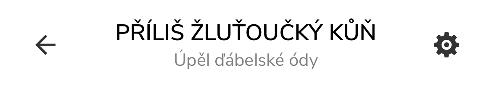
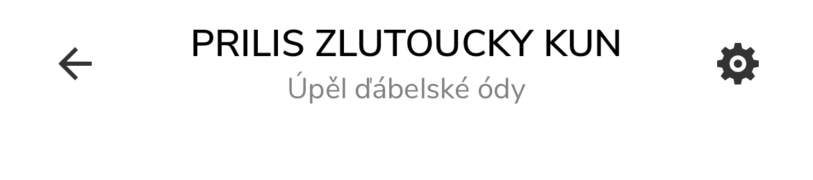

# TitleView repro: .NET 9 vs .NET 10 on iOS 26+/27

Minimal .NET MAUI app with a custom `NavigationPage.TitleView`, multi-targeting `net9.0-ios` and `net10.0-ios`.
The same code renders correctly on .NET 9 and loses the top of the title on .NET 10.

## Symptom

On .NET 10 the TitleView in the navigation bar is moved up by 5 pt and its top is clipped by the bar
(`UINavigationBar.clipsToBounds = true`). Diacritics above capital letters disappear:

| net9.0-ios (MAUI 9.0.120) | net10.0-ios (MAUI 10.0.120) |
|---|---|
|  |  |

Full output of the native layout dump is in [`results/`](results) (`net9-dump.txt`, `net10-dump.txt`).

## What differs (from the dumps)

Both run on the iOS 27.0 simulator, the navigation bar is 54 pt high in both (`sizeThatFits` = 54).

| | .NET 9 | .NET 10 |
|---|---|---|
| `NavigationRenderer.Container` frame | `(0,0 358×44)` | `(0,0 358×54)` |
| system title wrapper frame | `(16,0 358×44)` | `(16,-5 358×54)` |

On .NET 10 the container is sized to the navigation bar height instead of the height UIKit gives the title wrapper.
The wrapper then appears to be centred in a 44 pt slot (centre at y = 22; inferred from the dump, the slot itself is not
visible in the view hierarchy), so 5 pt end up above the bar, where `clipsToBounds` cuts them off.

In MAUI sources (`NavigationRenderer.cs`, class `Container`) this corresponds to:

* 9.0.90 / 9.0.120: `ToolbarHeight` returns `Superview.Bounds.Height` (fallback 44/32).
* 10.0.x: on iOS 26+ the container is created with `navigationBar.Frame` (`CreateTitleViewContainer`) and
  `ToolbarHeight` returns that cached `_navigationBarHeight` first. `Frame` setter and `SizeThatFits` then force it.

MAUI 10.0.120 (which contains the fix for dotnet/maui#39155) behaves the same.

The `clipsToBounds = true` on the bar is set in `NoLineNavigationPage` (hides the line below the bar);
without it the 5 pt overflow is not clipped, the title is only shifted up.

## Run

Requires Xcode 26.5 (for `net9.0-ios`) and Xcode 27.1 (for `net10.0-ios`), because each iOS workload checks the Xcode version.

```sh
./run.sh net9 --push     # build, run on the simulator, print the layout dump, save screenshots to bin/
./run.sh net10 --push
```

Paths to Xcode and the simulator can be changed through environment variables, see the header of `run.sh`.
A simulator (`TitleViewRepro iPhone-14 (iOS-27-0)`) is created on first run; delete it with `xcrun simctl delete <udid>`.
MAUI version per target framework: `-p:MauiVersionNet9=...` / `-p:MauiVersionNet10=...` (or `MAUI_NET9` / `MAUI_NET10` for `run.sh`).

Without the script: open the app, the buttons change the text, the secondary text and `HeightRequest`,
push another page and print the native layout (`Dump native layout`). The same component is placed in the page content for comparison.

## Notes

* Using the MAUI 9 package with the `net10.0-ios` target framework is not possible (the app crashes at startup:
  `MauiCALayerAutosizeToSuperLayerBehavior` native class not loaded).
* `net9.0-ios` is built against the iOS 26.5 SDK, `net10.0-ios` against 27.1. A `net10.0-ios` build against
  the 26.x SDK was not possible here (the workload requires exactly Xcode 26.0 for it).
* The fonts are Nunito Sans (SIL Open Font License).
